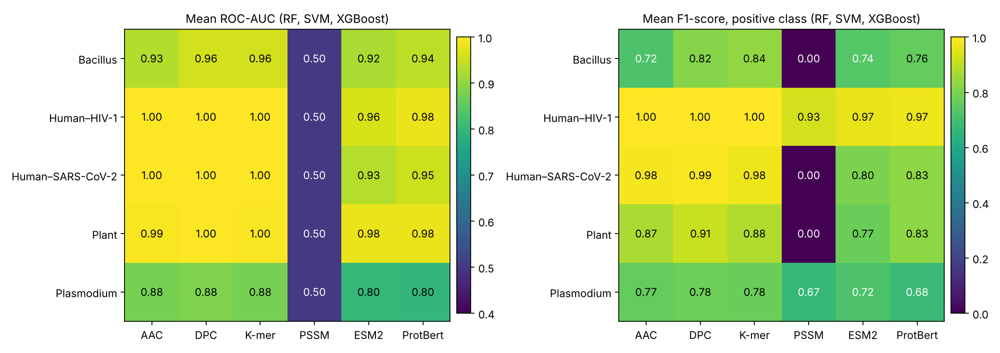

# Comparative Analysis of Protein Feature Extraction for Host–Pathogen PPI Prediction

A benchmarking study of **traditional sequence-derived features** versus **protein language model (PLM) embeddings** for predicting host–pathogen protein–protein interactions (PPIs). Features are extracted for protein pairs from five organism groups, classical ML models are trained on each representation, and every feature × model × organism combination is evaluated with confusion matrices, ROC curves and standard classification metrics.



*Mean ROC-AUC and positive-class F1, averaged over Random Forest, SVM and XGBoost. Derived from the 90 evaluated combinations in [`results/metrics/results_summary.csv`](results/metrics/results_summary.csv).*

## Study design

| Dimension | Coverage |
|---|---|
| **Organism groups** | Bacillus · Human–HIV-1 · Human–SARS-CoV-2 · Plant · Plasmodium |
| **Traditional features** | Amino Acid Composition (AAC) · Dipeptide Composition (DPC) · K-mer · Conjoint Triad (CTriad) · PSSM |
| **PLM embeddings** | ESM2 · ProtBert · ProtT5 |
| **Classical models** | Random Forest · SVM · XGBoost |
| **Deep models** | DNN · RNN · CNN |
| **Metrics** | Confusion matrix · ROC-AUC · accuracy · precision · recall · F1 |

> **Scope of the results shown below.** The figure set currently in `results/` covers **RF, SVM and XGBoost** on **AAC, DPC, K-mer, PSSM, ESM2 and ProtBert** for all five organism groups (5 × 6 × 3 = 90 combinations, 180 plots). CTriad, ProtT5 and the DNN/RNN/CNN models are part of the pipeline and are documented in [`docs/`](docs/), but their results are not yet included here.

## Key findings

Test-set sizes and class balance differ a lot between organisms, so accuracy alone is misleading (majority-class accuracy in the table). Mean ROC-AUC over RF/SVM/XGBoost:

| Organism | Test pairs (neg / pos) | Majority-class acc. | AAC | DPC | K-mer | PSSM | ESM2 | ProtBert |
|---|---|---|---|---|---|---|---|---|
| Bacillus | 1893 / 508 | 0.788 | 0.93 | 0.96 | 0.96 | 0.50 | 0.92 | 0.94 |
| Human–HIV-1 | 355 / 2483 | 0.875 | 1.00 | 1.00 | 1.00 | 0.50 | 0.96 | 0.98 |
| Human–SARS-CoV-2 | 126 / 64 | 0.663 | 1.00 | 1.00 | 1.00 | 0.50 | 0.93 | 0.95 |
| Plant | 513 / 104 | 0.831 | 0.99 | 1.00 | 1.00 | 0.50 | 0.98 | 0.98 |
| Plasmodium | 146 / 147 | 0.502 | 0.88 | 0.88 | 0.88 | 0.50 | 0.80 | 0.80 |

1. **Simple composition features were at least as good as PLM embeddings in every organism group.** Taken together, AAC/DPC/K-mer beat ESM2 and ProtBert on mean AUC and F1 in all five groups, despite being far cheaper to compute (individual exceptions exist, e.g. AAC alone trails ProtBert on Bacillus). This is a result about *this* benchmark and its splits, not a general claim about PLMs.
2. **The PSSM pipeline collapsed.** All 15 PSSM models (3 models × 5 organisms) output a single constant class, giving ROC-AUC = 0.50 and an accuracy equal to the majority-class baseline. Identical matrices from three very different learners point to a degenerate feature matrix upstream, not to a property of PSSM features. See [`docs/06_troubleshooting.md`](docs/06_troubleshooting.md) and [`results/summary/pssm_collapse_confusion_matrices.png`](results/summary/pssm_collapse_confusion_matrices.png). The non-zero PSSM F1 for HIV-1 and Plasmodium in the heatmap is an artefact of predicting *everything* positive.
3. **Possible data leakage in the HIV-1 and SARS-CoV-2 datasets.** Composition features reach AUC ≈ 1.00 (accuracy up to 99.96 % on HIV-1), while PLM embeddings, which should carry richer information, score lower (0.93–0.98). A perfect score that a stronger representation fails to reproduce is a classic signature of a dataset shortcut (e.g. negatives sampled differently from positives, or near-identical sequences on both sides of the split). This is flagged as a diagnostic finding that needs sequence-identity-aware splitting to confirm; see [`docs/07_reproducibility.md`](docs/07_reproducibility.md).
4. **Plasmodium is the hardest group** (balanced test set; best AUC 0.90 and best F1 0.82, both from XGBoost on AAC), so differences between representations are most visible there.

## Repository layout

```
.
├── README.md
├── requirements.txt
├── docs/                    # 7-part technical documentation
├── src/                     # the eight pipeline modules (see src/README.md)
├── data/                    # FASTA inputs, not tracked (see data/README.md)
└── results/
    ├── metrics/results_summary.csv      # 90 rows: confusion counts + metrics
    ├── summary/                         # heatmaps, PSSM-collapse figure
    └── figures/
        └── <organism>/<feature>/<model>_{confusion_matrix,roc_curve}.png
```

Per-organism galleries with every plot and metric: [`bacillus`](results/figures/bacillus/README.md) · [`human_hiv1`](results/figures/human_hiv1/README.md) · [`human_sars_cov2`](results/figures/human_sars_cov2/README.md) · [`plant`](results/figures/plant/README.md) · [`plasmodium`](results/figures/plasmodium/README.md)

## Documentation

| Part | Topic |
|---|---|
| [1](docs/01_project_overview.md) | Objectives, organism groups, dataset structure, workflow |
| [2](docs/02_feature_extraction_methods.md) | AAC, DPC, K-mer, CTriad, PSSM, ESM2, ProtBert, ProtT5 |
| [3](docs/03_machine_learning_models.md) | RF, SVM, XGBoost, DNN, RNN, CNN |
| [4](docs/04_source_code_reference.md) | The eight source files |
| [5](docs/05_evaluation_and_visualisation.md) | Train/test procedure, metrics, plots, result organisation |
| [6](docs/06_troubleshooting.md) | Error handling and troubleshooting |
| [7](docs/07_reproducibility.md) | Environment, execution, expected outputs, future work |

## Running the pipeline

```bash
git clone https://github.com/HeizenbergAdeyemi/Comparative-Analysis-of-Protein-Feature-Extraction-for-Host-Pathogen-PPI-Prediction.git
cd Comparative-Analysis-of-Protein-Feature-Extraction-for-Host-Pathogen-PPI-Prediction
pip install -r requirements.txt
python src/main_pipeline.py      # confirm arguments against main_pipeline.py
```

Full environment notes (BLAST+/SwissProt for PSSM, GPU/CUDA for PLMs and TensorFlow) are in [`docs/07_reproducibility.md`](docs/07_reproducibility.md).

## License

_To be added._
