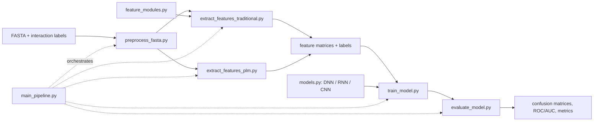

# Part 1 — Project overview

## Research objectives and scope

The project asks which protein representation best supports machine-learning prediction of **host–pathogen protein–protein interactions (PPIs)**, and whether large protein language models (PLMs) justify their computational cost relative to classical sequence-derived features.

Objectives:

1. Implement a common pipeline that turns FASTA sequences into numeric features using five traditional methods and three PLMs.
2. Train identical classifiers on every representation for every organism group, so that differences in performance can be attributed to the features.
3. Evaluate with confusion matrices, ROC curves/AUC, accuracy, precision, recall and F1, and organise the outputs so any combination can be inspected.
4. Record, rather than hide, the failure modes encountered (PSSM collapse, possible leakage), as these are part of the evidence on how reliable each representation is.

## Five organism groups

| Identifier | Host–pathogen system | Test pairs shown in results (neg / pos) |
|---|---|---|
| `bacillus` | Bacillus | 1893 / 508 |
| `human_hiv1` | Human–HIV-1 | 355 / 2483 |
| `human_sars_cov2` | Human–SARS-CoV-2 | 126 / 64 |
| `plant` | Plant–pathogen | 513 / 104 |
| `plasmodium` | Plasmodium | 146 / 147 |

The class balance varies from 50 % positive (Plasmodium) to 87.5 % positive (HIV-1), which is why every result is reported against a majority-class baseline (see Part 5).

> **TODO (author):** state, for each group, the source (database or publication), the pathogen species/host, how negative pairs were generated, and the train/test split sizes. The numbers above are the test-set totals visible in the confusion matrices.

## Dataset structure and FASTA organisation

> **TODO (author):** document the actual on-disk layout. Suggested form:
>
> ```
> data/raw/<organism>/
>     host_proteins.fasta
>     pathogen_proteins.fasta
>     interactions.csv        # host_id, pathogen_id, label
> ```
>
> Describe the header format (e.g. UniProt `>sp|ACC|NAME`), how sequence IDs link to interaction rows, and how `preprocess_fasta.py` handles duplicates, non-standard residues (`B, J, O, U, X, Z`) and length limits.

## Overall computational workflow

Flow implied by the responsibilities of the eight modules:



For each (organism, feature) pair the pipeline produces one feature matrix, trains each model on it, and writes plots and metrics to `results/figures/<organism>/<feature>/`.
