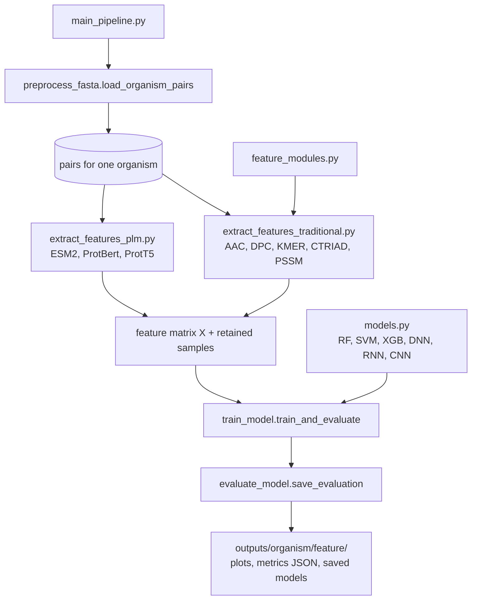

# Part 1 — Project overview

## Research objectives and scope

The project asks which protein representation best supports machine-learning prediction of **host–pathogen protein–protein interactions (PPIs)**, and whether large protein language models (PLMs) justify their computational cost relative to classical sequence-derived features.

Objectives:

1. Implement a common pipeline that turns FASTA sequences into numeric features using five traditional methods and three PLMs.
2. Train identical classifiers on every representation for every organism group, so differences in performance can be attributed to the features.
3. Evaluate with confusion matrices, ROC curves/AUC, accuracy, precision, recall and F1, and organise the outputs so any combination can be inspected.
4. Record, rather than hide, the failure modes encountered (PSSM collapse, possible leakage), as these are part of the evidence on how reliable each representation is.

## Five organism groups

| Identifier | Host–pathogen system | Test pairs in the shipped results (neg / pos) |
|---|---|---|
| `bacillus` | Bacillus | 1893 / 508 |
| `plant` | Plant–pathogen | 513 / 104 |
| `human_hiv1` | Human–HIV-1 | 355 / 2483 |
| `human_sars_cov2` | Human–SARS-CoV-2 | 126 / 64 |
| `plasmodium` | Plasmodium | 146 / 147 |

The class balance varies from 50 % positive (Plasmodium) to 87.5 % positive (HIV-1), which is why every result is reported against a majority-class baseline (Part 5). These test totals are consistent with the 20 % test split in `train_model.py`.

> **TODO (author):** state, for each group, the source database or publication, the host and pathogen species, and how non-interacting pairs were generated.

## Dataset structure and FASTA organisation

`preprocess_fasta.load_organism_pairs(data_root, organism)` expects four FASTA files per organism:

```
<data_root>/<organism>/
    interacting_host.fasta
    interacting_pathogen.fasta
    non_interacting_host.fasta
    non_interacting_pathogen.fasta
```

- **Pairing is by file order.** Record *i* of a host file is paired with record *i* of the matching pathogen file. The loader raises `ValueError` if the two files have different record counts, rather than risk misaligned pairs.
- **Accepted file names:** the exact stem, or the stem with `.fasta`, `.fa` or `.faa`; compressed (`.gz`) files are ignored.
- **Cleaning:** sequences are upper-cased, `*` is removed, and records that end up empty are dropped. Record IDs are the first word of the header. Biopython is used if installed; otherwise a built-in parser is used.
- **Output:** one dictionary per pair with `sample_id` (`<organism>_positive_<i>` or `<organism>_negative_<i>`), `host_id`, `pathogen_id`, `host_sequence`, `pathogen_sequence` and `label` (1 interacting, 0 non-interacting). Positives come first, then negatives; both classes must be present.

## Overall computational workflow



For each organism and each feature method, `main_pipeline.run_pipeline` extracts one feature matrix, checks that rows and labels line up and that both classes remain, then calls `train_and_evaluate`, which trains every requested model and calls `save_evaluation` for each. A failure in one feature method is caught, recorded as `{"error": ...}` in `outputs/<organism>_pipeline_summary.json`, and the run continues.
