# Bacillus — results gallery

Confusion matrices (rows = actual, columns = predicted; class 1 = interacting) and ROC curves for every feature × model combination. Numeric values: [`../../metrics/results_summary.csv`](../../metrics/results_summary.csv).

Test set shown in the plots: **1893 negative / 508 positive** (2401 pairs; majority-class accuracy = 0.788).

## AAC

| Model | Confusion matrix | ROC curve | Acc | Prec | Rec | F1 | AUC |
|---|---|---|---|---|---|---|---|
| RF |  | 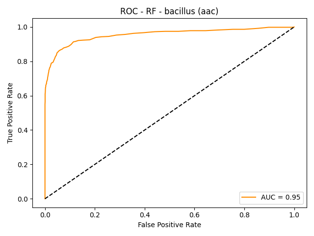 | 0.930 | 0.943 | 0.713 | 0.812 | 0.95 |
| SVM |  | 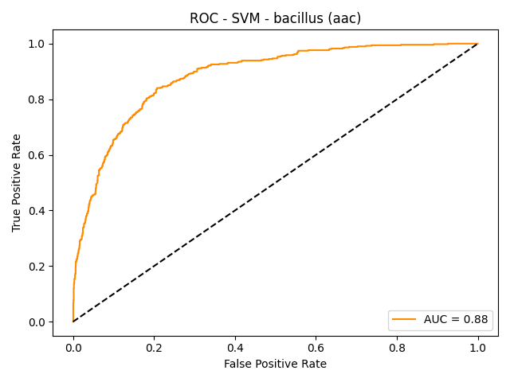 | 0.843 | 0.739 | 0.402 | 0.520 | 0.88 |
| XGB |  | 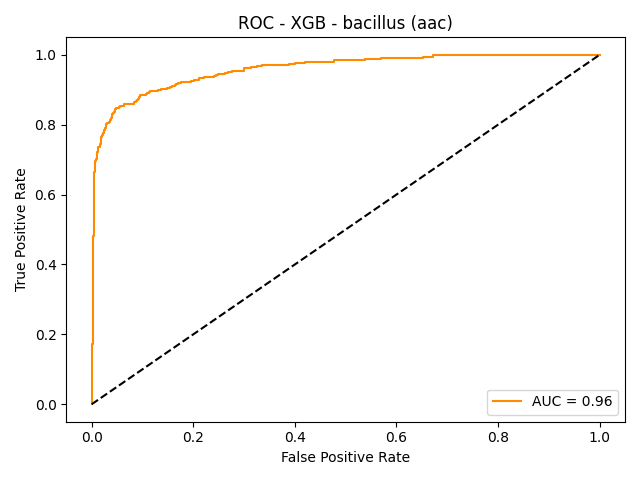 | 0.931 | 0.849 | 0.819 | 0.834 | 0.96 |

## DPC

| Model | Confusion matrix | ROC curve | Acc | Prec | Rec | F1 | AUC |
|---|---|---|---|---|---|---|---|
| RF |  | 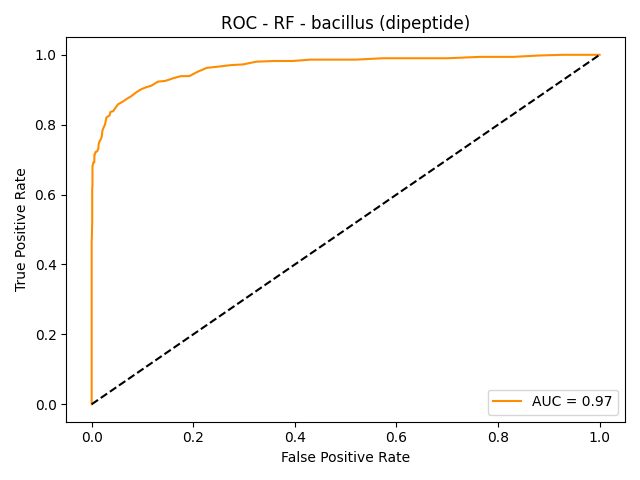 | 0.935 | 0.958 | 0.722 | 0.824 | 0.97 |
| SVM | 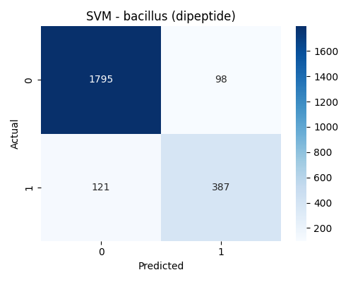 | 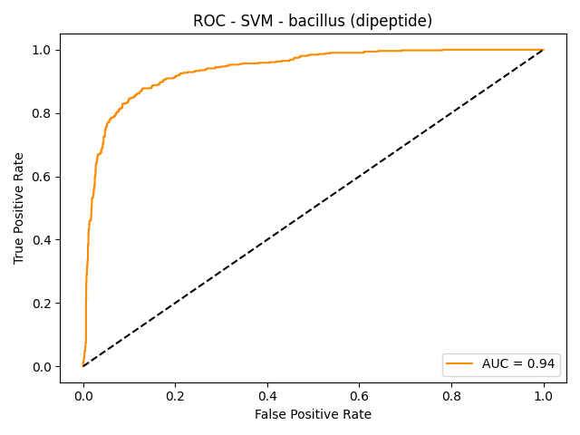 | 0.909 | 0.798 | 0.762 | 0.779 | 0.94 |
| XGB |  |  | 0.939 | 0.868 | 0.841 | 0.854 | 0.97 |

## K-mer

| Model | Confusion matrix | ROC curve | Acc | Prec | Rec | F1 | AUC |
|---|---|---|---|---|---|---|---|
| RF |  | 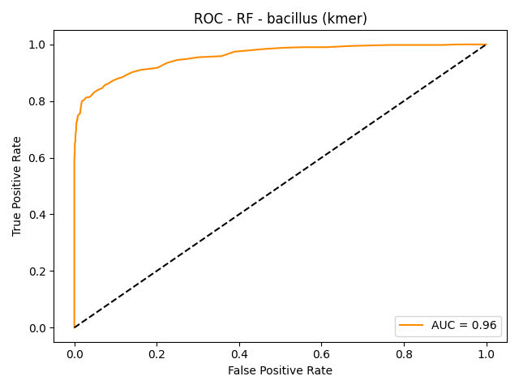 | 0.939 | 0.962 | 0.742 | 0.838 | 0.96 |
| SVM |  |  | 0.930 | 0.865 | 0.791 | 0.826 | 0.96 |
| XGB | 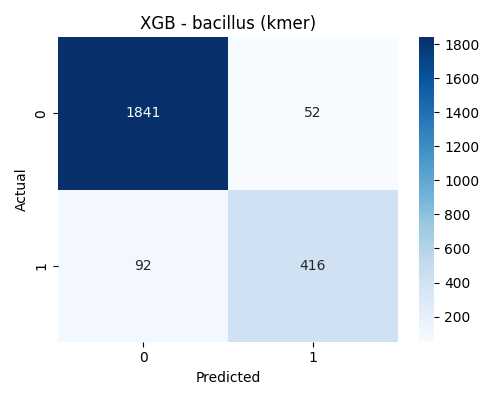 | 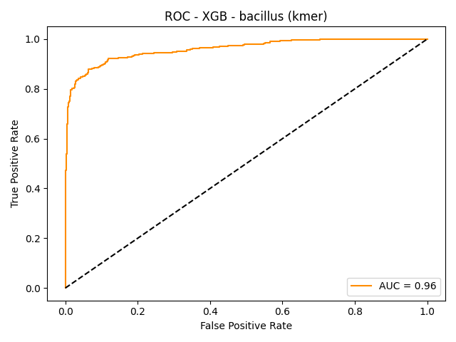 | 0.940 | 0.889 | 0.819 | 0.852 | 0.96 |

## PSSM

| Model | Confusion matrix | ROC curve | Acc | Prec | Rec | F1 | AUC |
|---|---|---|---|---|---|---|---|
| RF | 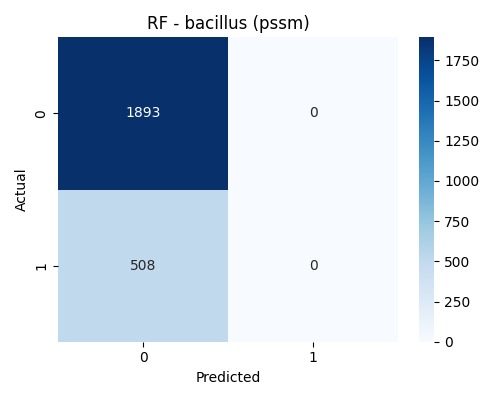 |  | 0.788 | 0.000 | 0.000 | 0.000 | 0.50 |
| SVM |  |  | 0.788 | 0.000 | 0.000 | 0.000 | 0.50 |
| XGB |  | 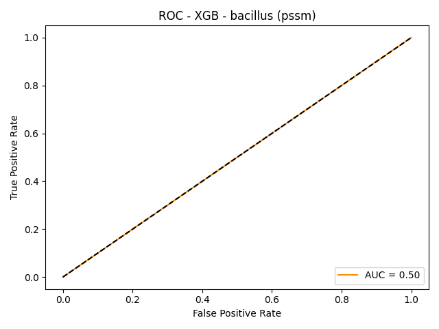 | 0.788 | 0.000 | 0.000 | 0.000 | 0.50 |

## ESM2

| Model | Confusion matrix | ROC curve | Acc | Prec | Rec | F1 | AUC |
|---|---|---|---|---|---|---|---|
| RF | 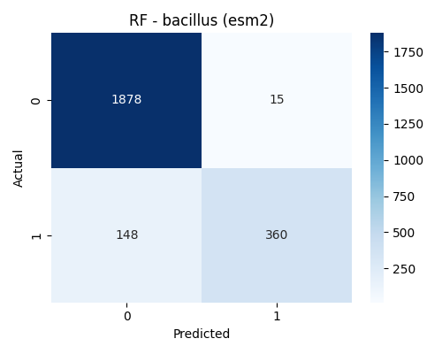 |  | 0.932 | 0.960 | 0.709 | 0.815 | 0.93 |
| SVM | 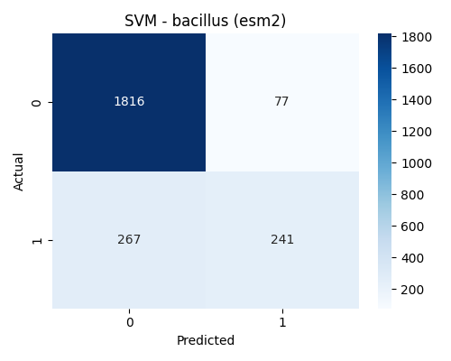 | 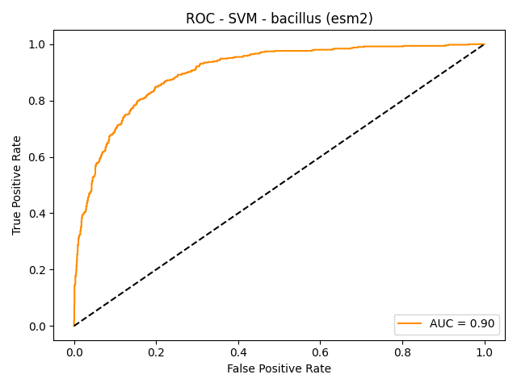 | 0.857 | 0.758 | 0.474 | 0.584 | 0.90 |
| XGB |  | 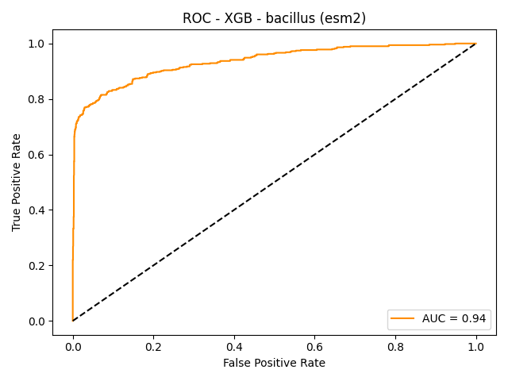 | 0.926 | 0.886 | 0.748 | 0.811 | 0.94 |

## ProtBert

| Model | Confusion matrix | ROC curve | Acc | Prec | Rec | F1 | AUC |
|---|---|---|---|---|---|---|---|
| RF |  | 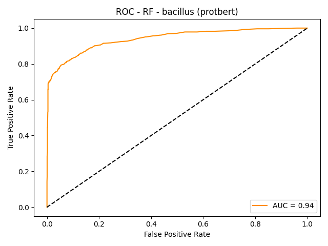 | 0.929 | 0.945 | 0.707 | 0.809 | 0.94 |
| SVM | 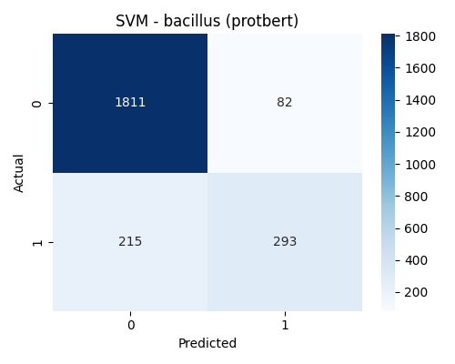 | 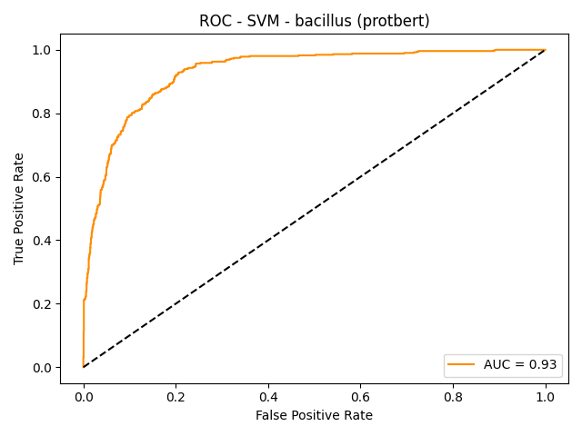 | 0.876 | 0.781 | 0.577 | 0.664 | 0.93 |
| XGB | 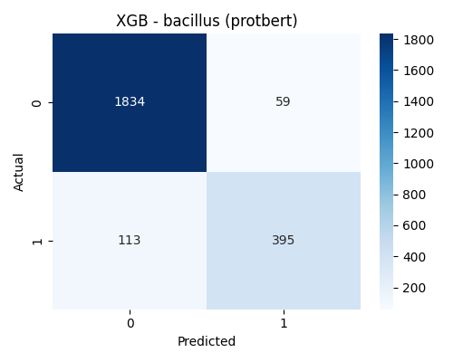 | 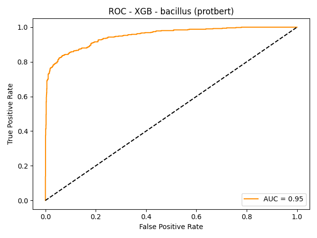 | 0.928 | 0.870 | 0.778 | 0.821 | 0.95 |
