# Human–HIV-1 — results gallery

Confusion matrices (rows = actual, columns = predicted; class 1 = interacting) and ROC curves for every feature × model combination. Numeric values: [`../../metrics/results_summary.csv`](../../metrics/results_summary.csv).

Test set shown in the plots: **355 negative / 2483 positive** (2838 pairs; majority-class accuracy = 0.875).

## AAC

| Model | Confusion matrix | ROC curve | Acc | Prec | Rec | F1 | AUC |
|---|---|---|---|---|---|---|---|
| RF |  | 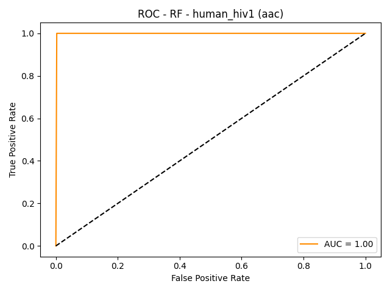 | 0.999 | 0.999 | 1.000 | 0.999 | 1.00 |
| SVM | 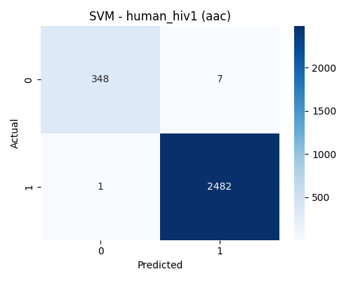 | 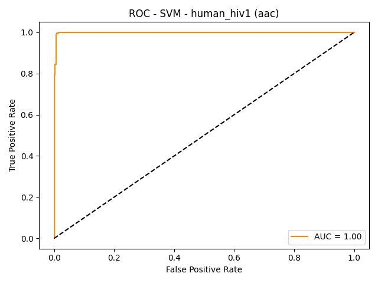 | 0.997 | 0.997 | 1.000 | 0.998 | 1.00 |
| XGB |  |  | 0.999 | 0.999 | 1.000 | 0.999 | 1.00 |

## DPC

| Model | Confusion matrix | ROC curve | Acc | Prec | Rec | F1 | AUC |
|---|---|---|---|---|---|---|---|
| RF | 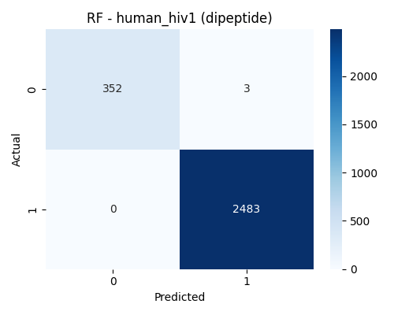 | 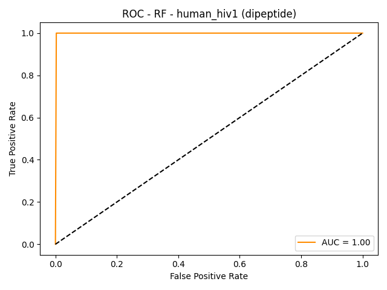 | 0.999 | 0.999 | 1.000 | 0.999 | 1.00 |
| SVM |  |  | 0.997 | 0.999 | 0.998 | 0.998 | 1.00 |
| XGB |  |  | 1.000 | 1.000 | 1.000 | 1.000 | 1.00 |

## K-mer

| Model | Confusion matrix | ROC curve | Acc | Prec | Rec | F1 | AUC |
|---|---|---|---|---|---|---|---|
| RF |  |  | 0.998 | 0.998 | 1.000 | 0.999 | 1.00 |
| SVM |  |  | 0.993 | 0.999 | 0.993 | 0.996 | 1.00 |
| XGB |  | 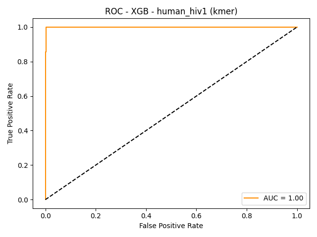 | 1.000 | 1.000 | 1.000 | 1.000 | 1.00 |

## PSSM

| Model | Confusion matrix | ROC curve | Acc | Prec | Rec | F1 | AUC |
|---|---|---|---|---|---|---|---|
| RF |  | 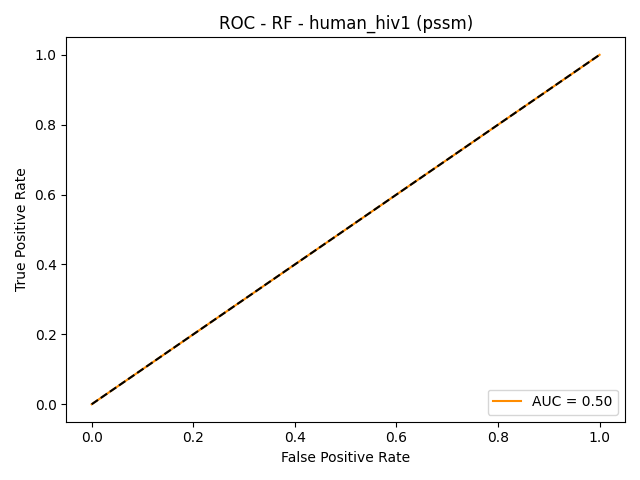 | 0.875 | 0.875 | 1.000 | 0.933 | 0.50 |
| SVM |  | 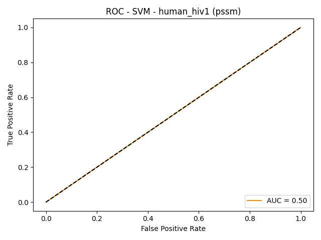 | 0.875 | 0.875 | 1.000 | 0.933 | 0.50 |
| XGB | 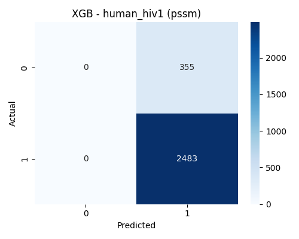 |  | 0.875 | 0.875 | 1.000 | 0.933 | 0.50 |

## ESM2

| Model | Confusion matrix | ROC curve | Acc | Prec | Rec | F1 | AUC |
|---|---|---|---|---|---|---|---|
| RF |  | 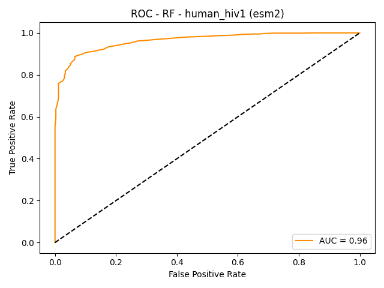 | 0.921 | 0.927 | 0.987 | 0.956 | 0.96 |
| SVM |  | 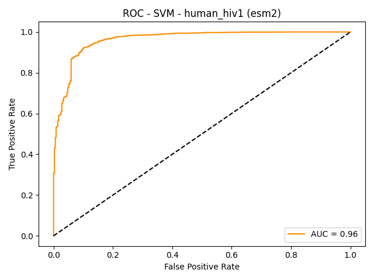 | 0.946 | 0.952 | 0.988 | 0.970 | 0.96 |
| XGB | 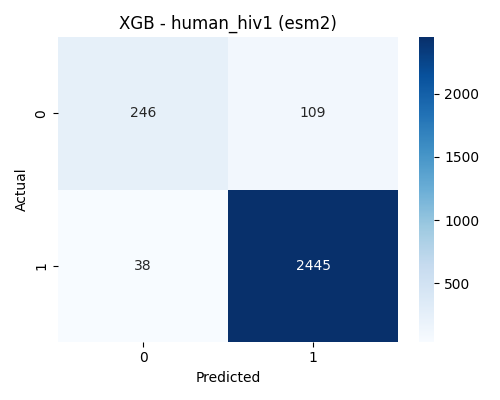 |  | 0.948 | 0.957 | 0.985 | 0.971 | 0.97 |

## ProtBert

| Model | Confusion matrix | ROC curve | Acc | Prec | Rec | F1 | AUC |
|---|---|---|---|---|---|---|---|
| RF |  | 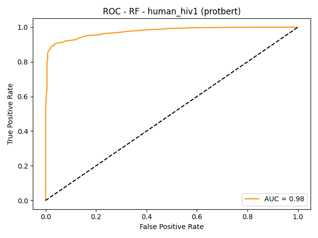 | 0.933 | 0.939 | 0.988 | 0.963 | 0.98 |
| SVM |  |  | 0.969 | 0.973 | 0.992 | 0.983 | 0.99 |
| XGB |  | 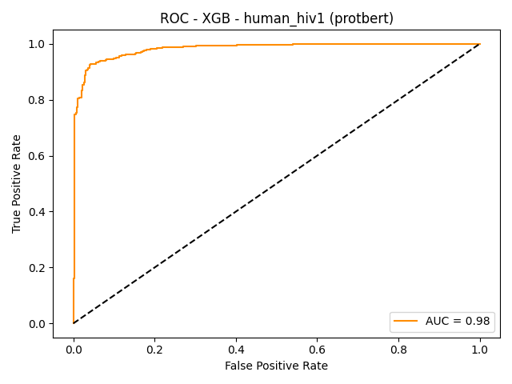 | 0.961 | 0.968 | 0.988 | 0.978 | 0.98 |
