# Human–SARS-CoV-2 — results gallery

Confusion matrices (rows = actual, columns = predicted; class 1 = interacting) and ROC curves for every feature × model combination. Numeric values: [`../../metrics/results_summary.csv`](../../metrics/results_summary.csv).

Test set shown in the plots: **126 negative / 64 positive** (190 pairs; majority-class accuracy = 0.663).

## AAC

| Model | Confusion matrix | ROC curve | Acc | Prec | Rec | F1 | AUC |
|---|---|---|---|---|---|---|---|
| RF | 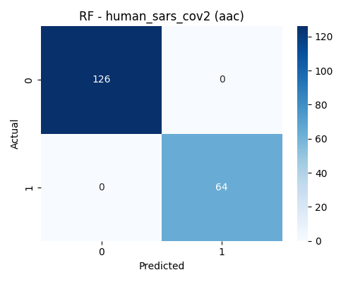 |  | 1.000 | 1.000 | 1.000 | 1.000 | 1.00 |
| SVM |  |  | 0.984 | 0.984 | 0.969 | 0.976 | 1.00 |
| XGB |  |  | 0.984 | 0.955 | 1.000 | 0.977 | 1.00 |

## DPC

| Model | Confusion matrix | ROC curve | Acc | Prec | Rec | F1 | AUC |
|---|---|---|---|---|---|---|---|
| RF |  |  | 1.000 | 1.000 | 1.000 | 1.000 | 1.00 |
| SVM |  |  | 0.984 | 1.000 | 0.953 | 0.976 | 1.00 |
| XGB |  | 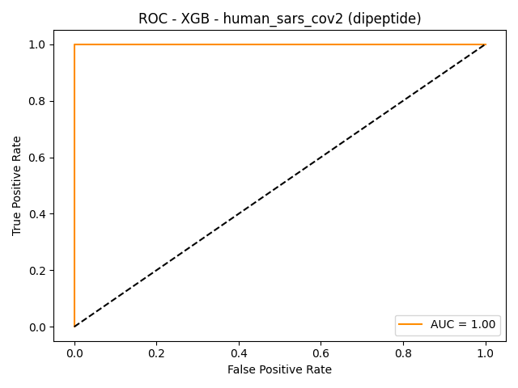 | 1.000 | 1.000 | 1.000 | 1.000 | 1.00 |

## K-mer

| Model | Confusion matrix | ROC curve | Acc | Prec | Rec | F1 | AUC |
|---|---|---|---|---|---|---|---|
| RF |  |  | 0.995 | 1.000 | 0.984 | 0.992 | 1.00 |
| SVM | 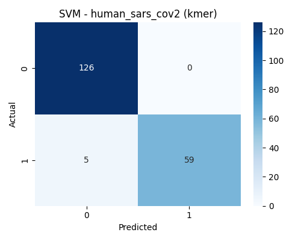 |  | 0.974 | 1.000 | 0.922 | 0.959 | 1.00 |
| XGB |  |  | 0.984 | 0.969 | 0.984 | 0.977 | 1.00 |

## PSSM

| Model | Confusion matrix | ROC curve | Acc | Prec | Rec | F1 | AUC |
|---|---|---|---|---|---|---|---|
| RF | 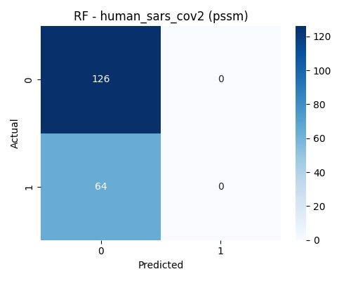 |  | 0.663 | 0.000 | 0.000 | 0.000 | 0.50 |
| SVM |  |  | 0.663 | 0.000 | 0.000 | 0.000 | 0.50 |
| XGB |  | 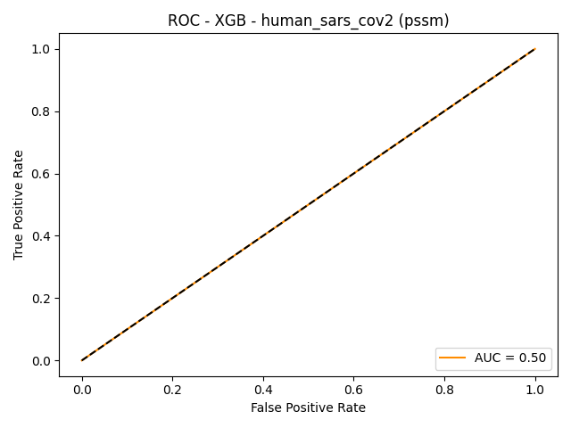 | 0.663 | 0.000 | 0.000 | 0.000 | 0.50 |

## ESM2

| Model | Confusion matrix | ROC curve | Acc | Prec | Rec | F1 | AUC |
|---|---|---|---|---|---|---|---|
| RF | 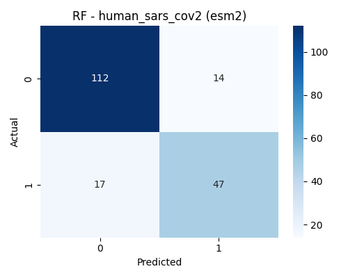 | 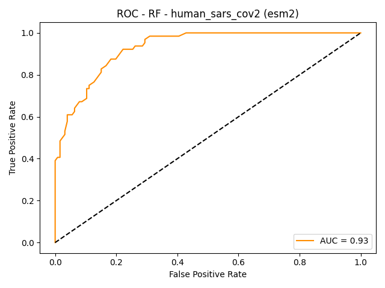 | 0.837 | 0.770 | 0.734 | 0.752 | 0.93 |
| SVM | 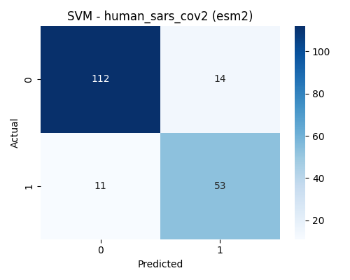 | 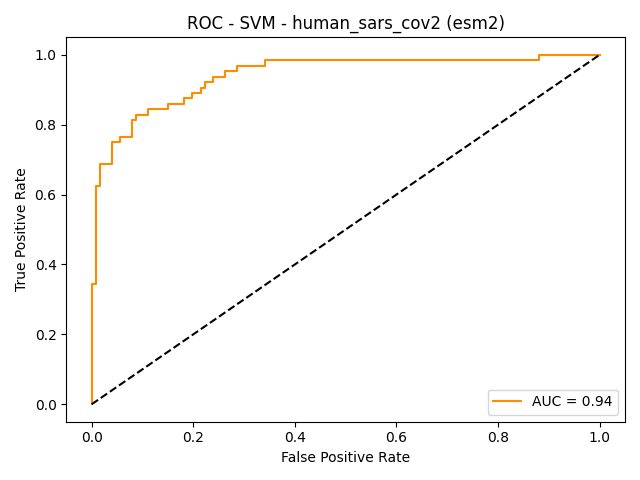 | 0.868 | 0.791 | 0.828 | 0.809 | 0.94 |
| XGB | 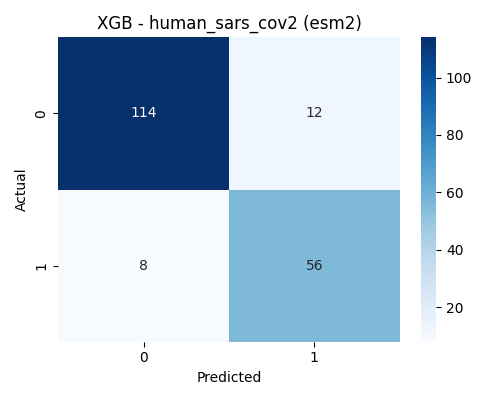 | 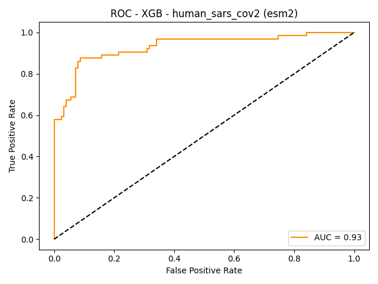 | 0.895 | 0.824 | 0.875 | 0.848 | 0.93 |

## ProtBert

| Model | Confusion matrix | ROC curve | Acc | Prec | Rec | F1 | AUC |
|---|---|---|---|---|---|---|---|
| RF | 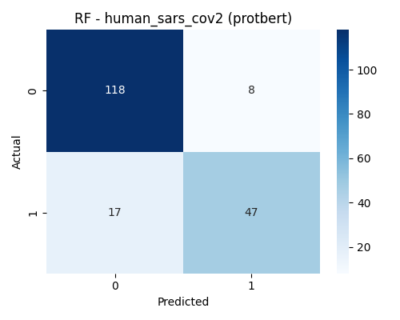 | 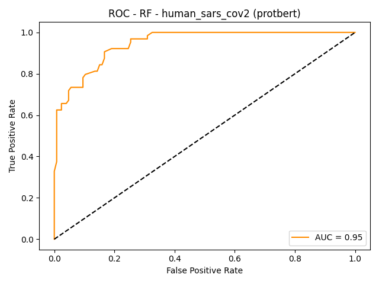 | 0.868 | 0.855 | 0.734 | 0.790 | 0.95 |
| SVM |  | 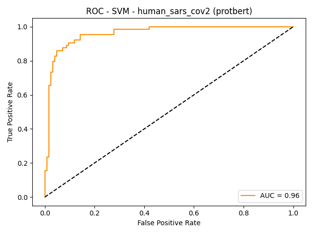 | 0.916 | 0.900 | 0.844 | 0.871 | 0.96 |
| XGB |  | 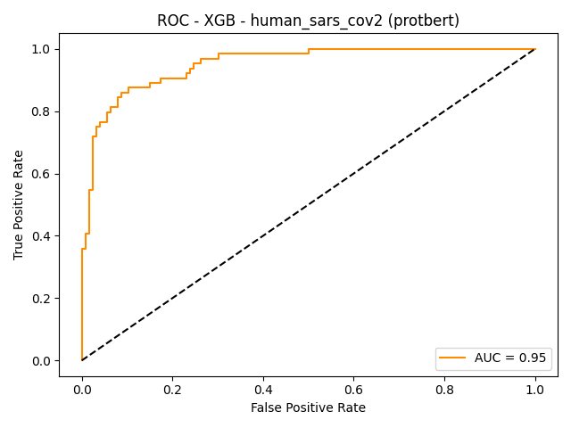 | 0.889 | 0.841 | 0.828 | 0.835 | 0.95 |
