# Plant — results gallery

Confusion matrices (rows = actual, columns = predicted; class 1 = interacting) and ROC curves for every feature × model combination. Numeric values: [`../../metrics/results_summary.csv`](../../metrics/results_summary.csv).

Test set shown in the plots: **513 negative / 104 positive** (617 pairs; majority-class accuracy = 0.831).

## AAC

| Model | Confusion matrix | ROC curve | Acc | Prec | Rec | F1 | AUC |
|---|---|---|---|---|---|---|---|
| RF | 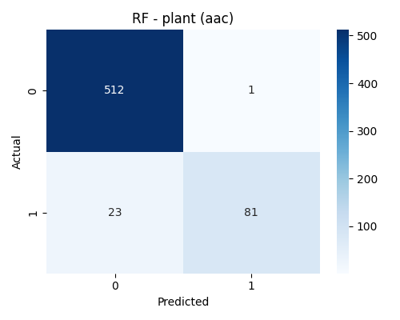 | 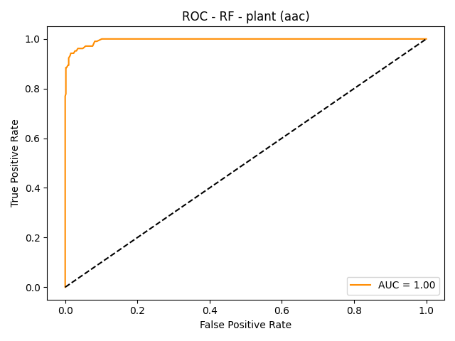 | 0.961 | 0.988 | 0.779 | 0.871 | 1.00 |
| SVM |  |  | 0.951 | 0.987 | 0.721 | 0.833 | 0.98 |
| XGB |  | 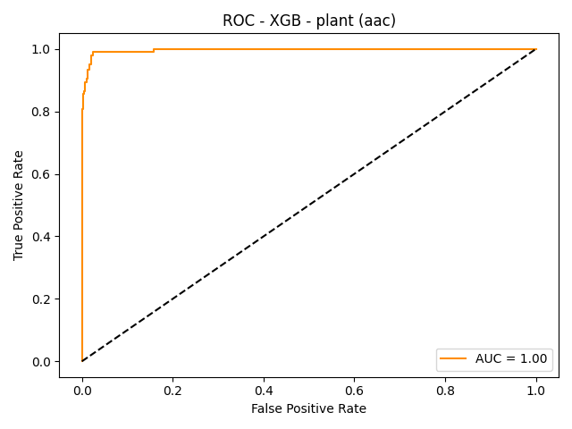 | 0.974 | 0.989 | 0.856 | 0.918 | 1.00 |

## DPC

| Model | Confusion matrix | ROC curve | Acc | Prec | Rec | F1 | AUC |
|---|---|---|---|---|---|---|---|
| RF | 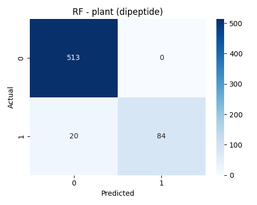 | 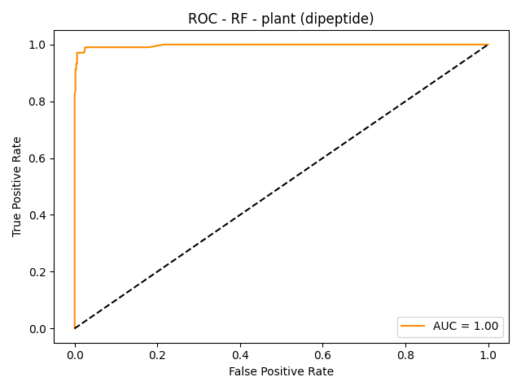 | 0.968 | 1.000 | 0.808 | 0.894 | 1.00 |
| SVM | 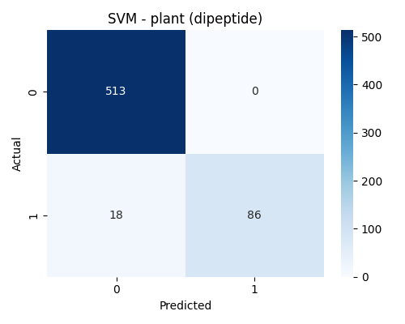 |  | 0.971 | 1.000 | 0.827 | 0.905 | 1.00 |
| XGB |  | 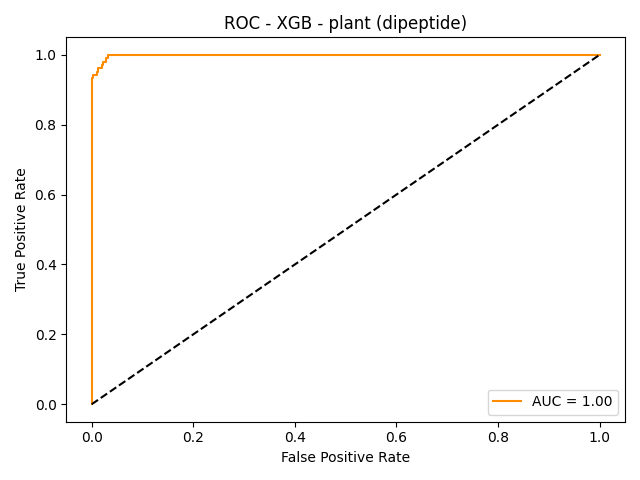 | 0.982 | 1.000 | 0.894 | 0.944 | 1.00 |

## K-mer

| Model | Confusion matrix | ROC curve | Acc | Prec | Rec | F1 | AUC |
|---|---|---|---|---|---|---|---|
| RF |  | 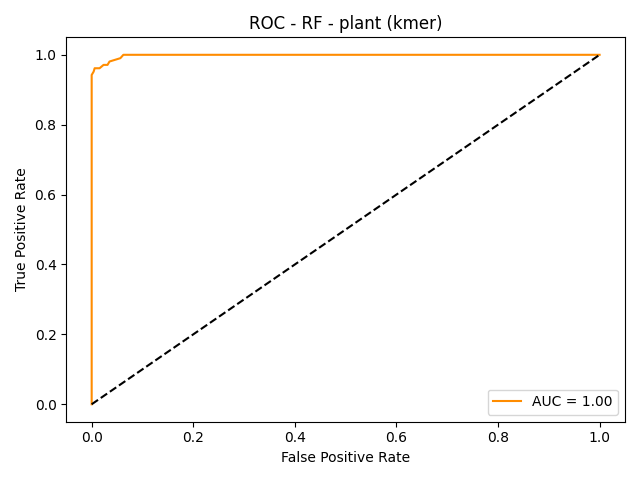 | 0.963 | 1.000 | 0.779 | 0.876 | 1.00 |
| SVM |  | 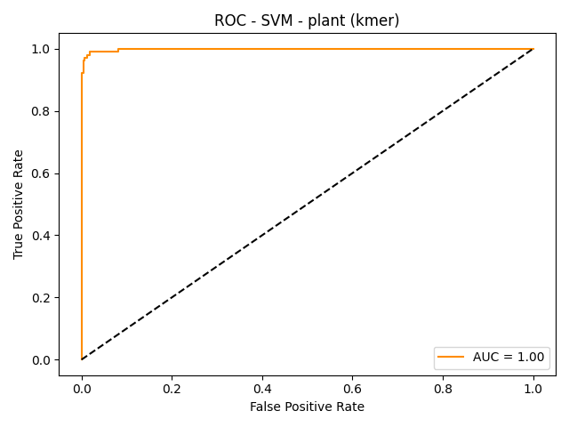 | 0.956 | 1.000 | 0.740 | 0.851 | 1.00 |
| XGB |  | 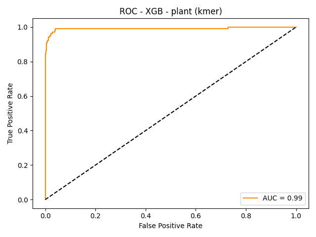 | 0.974 | 1.000 | 0.846 | 0.917 | 0.99 |

## PSSM

| Model | Confusion matrix | ROC curve | Acc | Prec | Rec | F1 | AUC |
|---|---|---|---|---|---|---|---|
| RF | 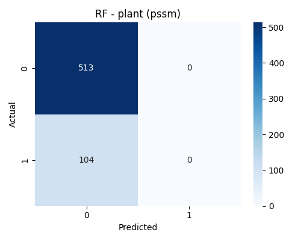 | 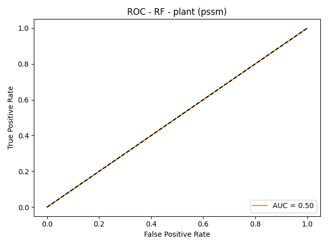 | 0.831 | 0.000 | 0.000 | 0.000 | 0.50 |
| SVM |  | 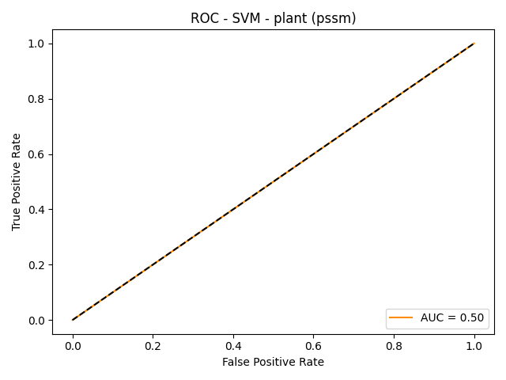 | 0.831 | 0.000 | 0.000 | 0.000 | 0.50 |
| XGB | 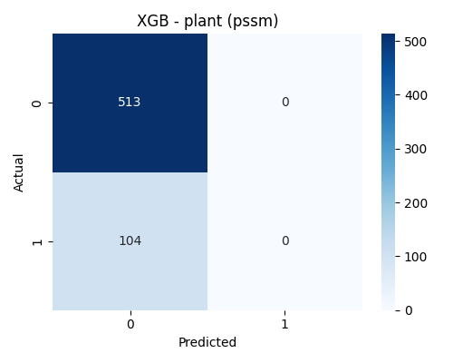 |  | 0.831 | 0.000 | 0.000 | 0.000 | 0.50 |

## ESM2

| Model | Confusion matrix | ROC curve | Acc | Prec | Rec | F1 | AUC |
|---|---|---|---|---|---|---|---|
| RF |  |  | 0.921 | 1.000 | 0.529 | 0.692 | 0.99 |
| SVM | 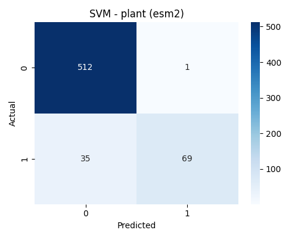 |  | 0.942 | 0.986 | 0.663 | 0.793 | 0.98 |
| XGB |  | 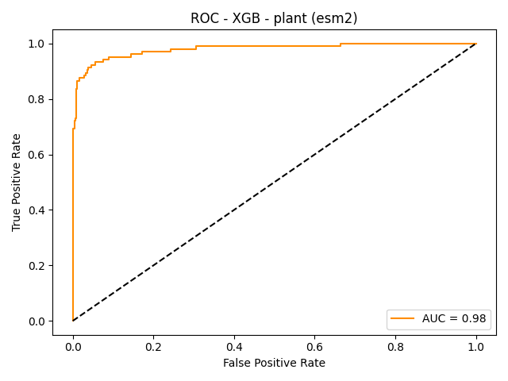 | 0.951 | 0.951 | 0.750 | 0.839 | 0.98 |

## ProtBert

| Model | Confusion matrix | ROC curve | Acc | Prec | Rec | F1 | AUC |
|---|---|---|---|---|---|---|---|
| RF |  | 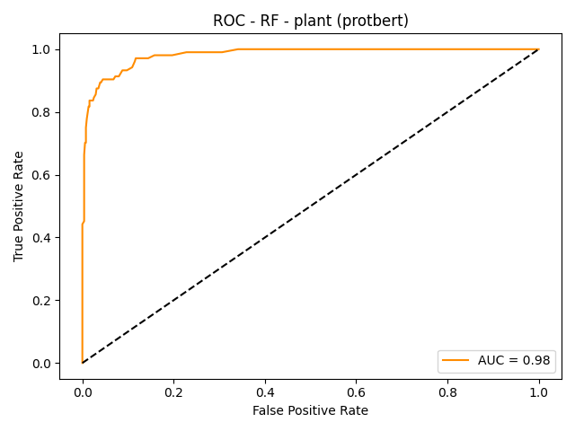 | 0.937 | 0.971 | 0.644 | 0.775 | 0.98 |
| SVM |  | 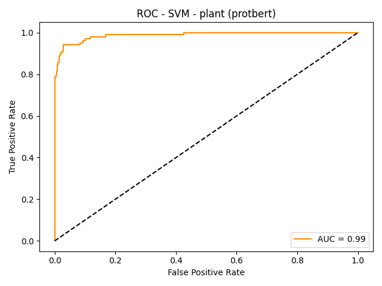 | 0.963 | 0.966 | 0.808 | 0.880 | 0.99 |
| XGB |  |  | 0.951 | 0.951 | 0.750 | 0.839 | 0.98 |
