# Plasmodium — results gallery

Confusion matrices (rows = actual, columns = predicted; class 1 = interacting) and ROC curves for every feature × model combination. Numeric values: [`../../metrics/results_summary.csv`](../../metrics/results_summary.csv).

Test set shown in the plots: **146 negative / 147 positive** (293 pairs; majority-class accuracy = 0.502).

## AAC

| Model | Confusion matrix | ROC curve | Acc | Prec | Rec | F1 | AUC |
|---|---|---|---|---|---|---|---|
| RF |  | 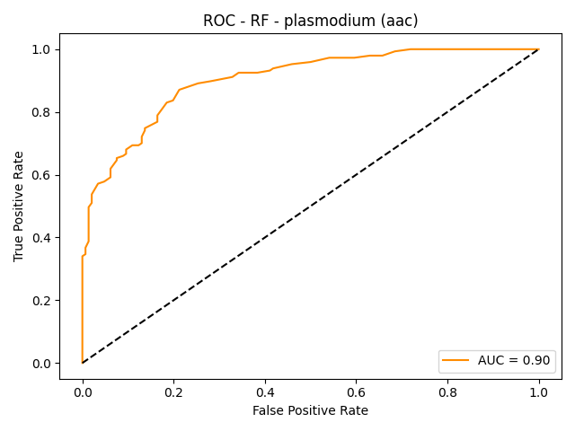 | 0.792 | 0.864 | 0.694 | 0.770 | 0.90 |
| SVM |  | 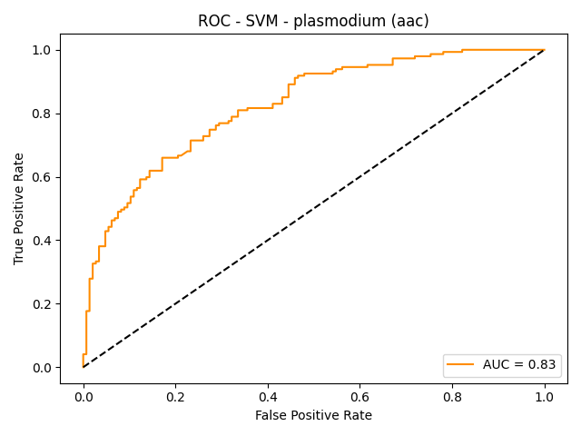 | 0.730 | 0.770 | 0.660 | 0.711 | 0.83 |
| XGB | 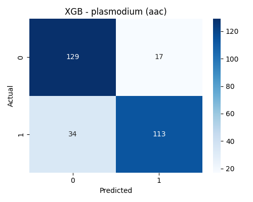 |  | 0.826 | 0.869 | 0.769 | 0.816 | 0.90 |

## DPC

| Model | Confusion matrix | ROC curve | Acc | Prec | Rec | F1 | AUC |
|---|---|---|---|---|---|---|---|
| RF | 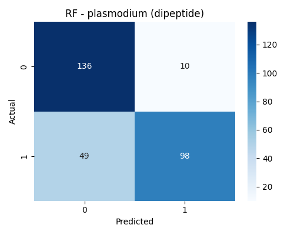 | 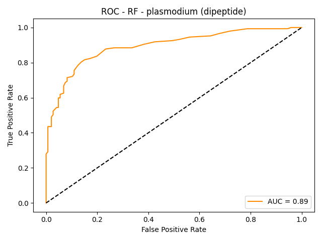 | 0.799 | 0.907 | 0.667 | 0.769 | 0.89 |
| SVM | 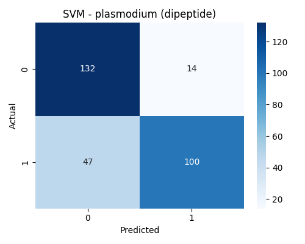 | 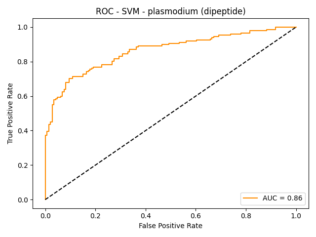 | 0.792 | 0.877 | 0.680 | 0.766 | 0.86 |
| XGB |  | 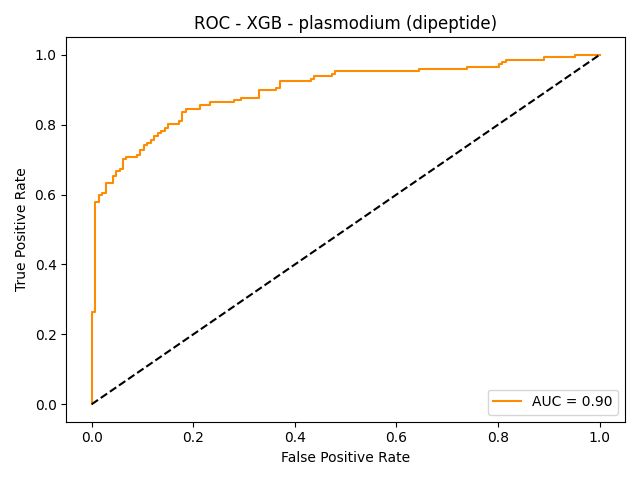 | 0.816 | 0.866 | 0.748 | 0.803 | 0.90 |

## K-mer

| Model | Confusion matrix | ROC curve | Acc | Prec | Rec | F1 | AUC |
|---|---|---|---|---|---|---|---|
| RF |  | 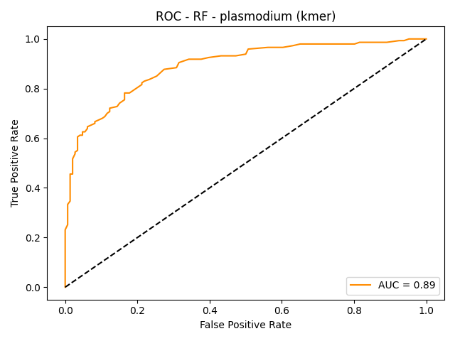 | 0.792 | 0.852 | 0.707 | 0.773 | 0.89 |
| SVM |  |  | 0.799 | 0.893 | 0.680 | 0.772 | 0.86 |
| XGB | 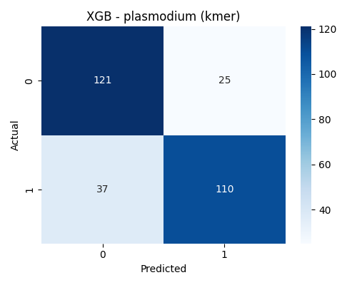 | 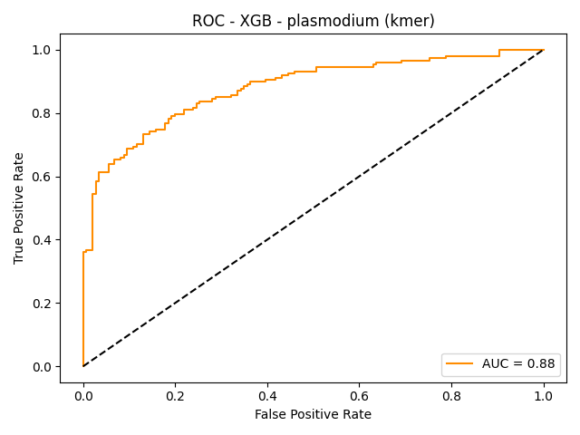 | 0.788 | 0.815 | 0.748 | 0.780 | 0.88 |

## PSSM

| Model | Confusion matrix | ROC curve | Acc | Prec | Rec | F1 | AUC |
|---|---|---|---|---|---|---|---|
| RF | 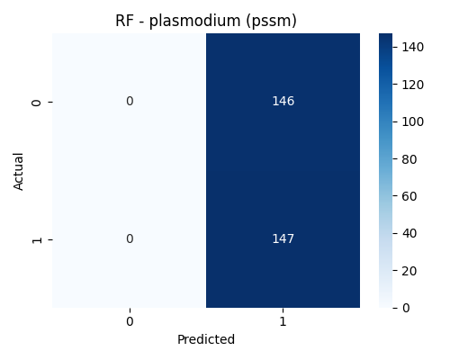 | 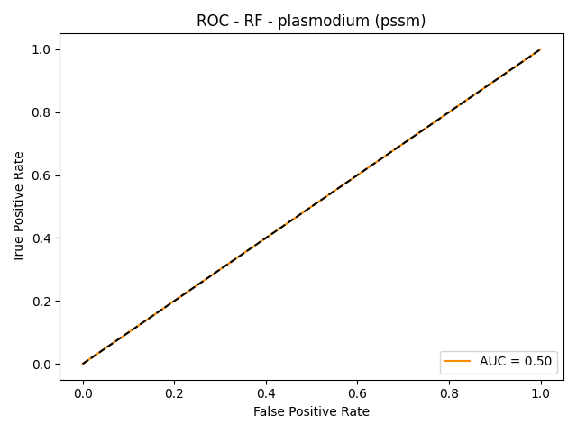 | 0.502 | 0.502 | 1.000 | 0.668 | 0.50 |
| SVM |  | 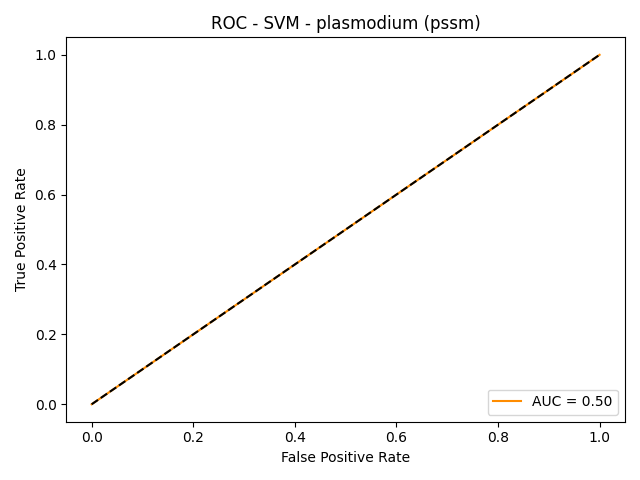 | 0.502 | 0.502 | 1.000 | 0.668 | 0.50 |
| XGB |  |  | 0.502 | 0.502 | 1.000 | 0.668 | 0.50 |

## ESM2

| Model | Confusion matrix | ROC curve | Acc | Prec | Rec | F1 | AUC |
|---|---|---|---|---|---|---|---|
| RF |  | 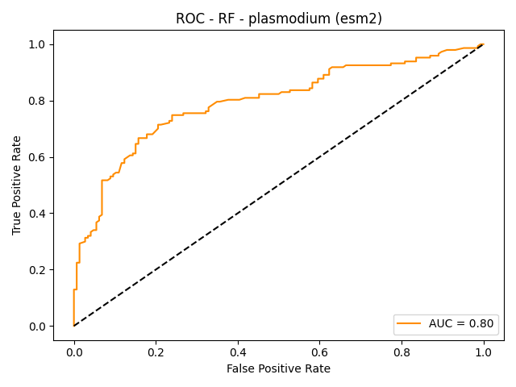 | 0.744 | 0.790 | 0.667 | 0.723 | 0.80 |
| SVM | 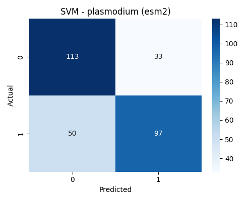 | 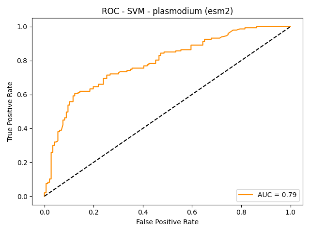 | 0.717 | 0.746 | 0.660 | 0.700 | 0.79 |
| XGB | 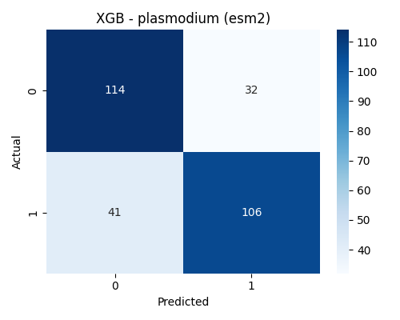 | 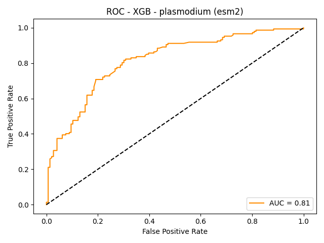 | 0.751 | 0.768 | 0.721 | 0.744 | 0.81 |

## ProtBert

| Model | Confusion matrix | ROC curve | Acc | Prec | Rec | F1 | AUC |
|---|---|---|---|---|---|---|---|
| RF |  | 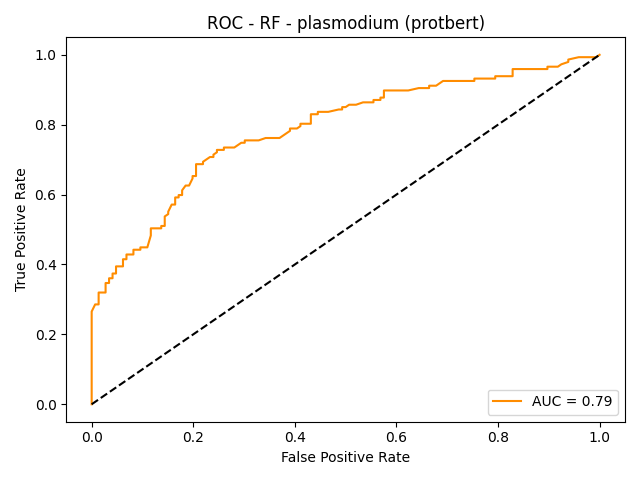 | 0.717 | 0.767 | 0.626 | 0.689 | 0.79 |
| SVM | 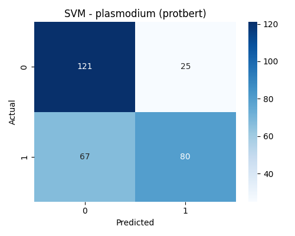 | 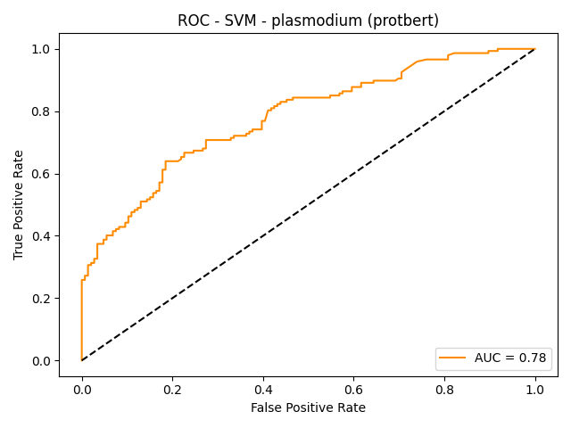 | 0.686 | 0.762 | 0.544 | 0.635 | 0.78 |
| XGB |  | 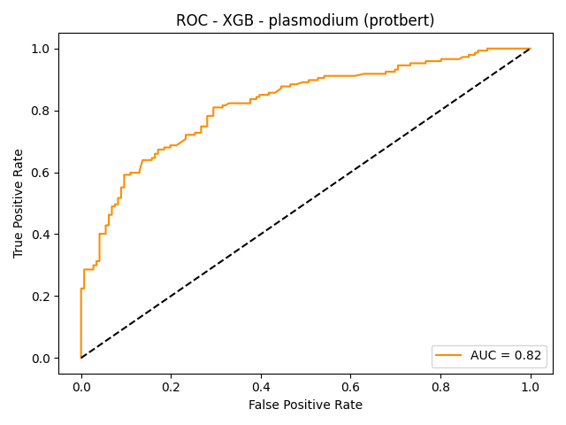 | 0.744 | 0.786 | 0.673 | 0.725 | 0.82 |
